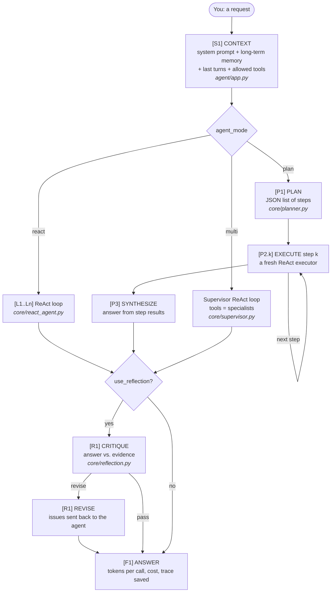
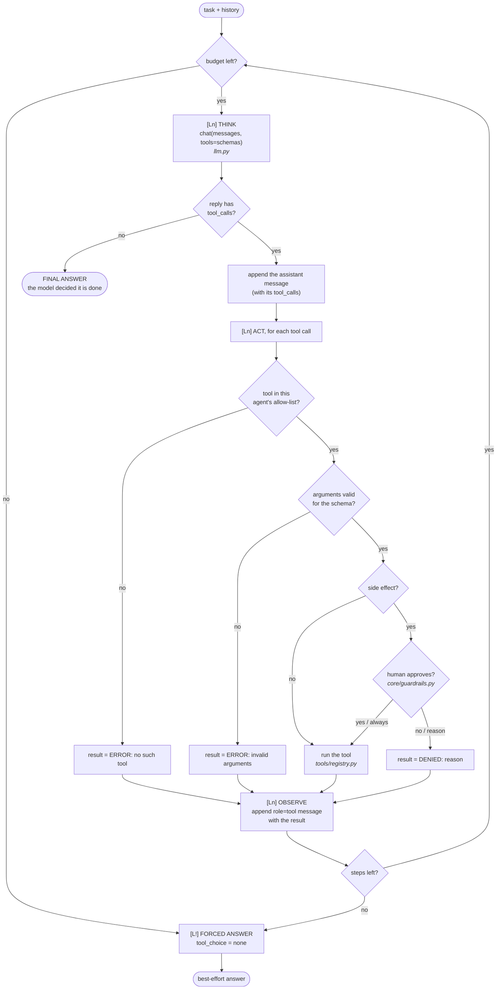
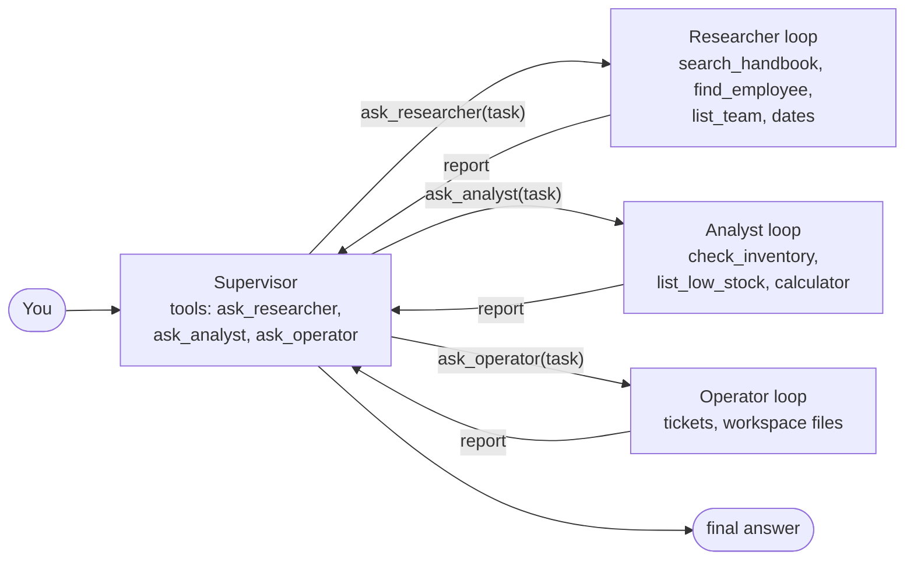

# Flow Diagrams

Each box has a code (`[S1]`, `[L2]`, `[P2.1]`, …). The same code appears as a header in the terminal logs, so you can match what you read here to what you see there.

---

## 1. The whole question



---

## 2. Inside the ReAct loop (one agent run)



Errors, denials and unknown tools are **not** exceptions. All of them become a tool result that the model reads in the next step, which is how an agent corrects itself.

---

## 3. What the messages look like after two steps

This is the agent's entire working memory. It is re-sent in full on **every** call:

```
[0] system     You are the Nimbus Ops Assistant ... (rules, memory)
[1] user       Is Priya due for a laptop refresh?
[2] assistant  "I'll look up Priya and the refresh policy."
               tool_calls: find_employee({"query":"Priya"}), search_handbook({"query":"laptop refresh"})
[3] tool       (id of call 1) [{"id": "E102", "name": "Priya Natarajan", ... "laptop_purchased": "2023-08-14"}]
[4] tool       (id of call 2) [Equipment > Laptop refresh cycle] Every employee laptop is replaced after 36 months ...
[5] assistant  "I need today's date to compute the laptop's age."
               tool_calls: get_current_datetime({})
[6] tool       (id of call 3) 2026-10-25 14:02 (Sunday) ...
--> next call: THINK on messages [0..6]
```

Type `/verbosity 3` to see this table in the logs at every step.

---

## 4. Multi-agent: specialists are tools



Each specialist gets **only** its task string and starts with a fresh message list. It does not see the conversation.

---

## 5. File-to-step table

| Code | Step | File |
|---|---|---|
| S1 | Assemble context: prompt, memory, tools | `agent/app.py`, `agent/prompts.py` |
| L*n* THINK | One model call with tool schemas | `agent/core/react_agent.py`, `agent/llm.py` |
| L*n* ACT | Allow-list, validation, approval, execution | `agent/core/react_agent.py`, `agent/tools/registry.py`, `agent/core/guardrails.py` |
| L*n* OBSERVE | Append the tool result | `agent/core/react_agent.py` |
| L! | Forced final answer (step limit or budget) | `agent/core/react_agent.py` |
| P1 / P2.k / P3 | Plan, execute steps, synthesize | `agent/core/planner.py` |
| (multi) | Supervisor + specialists as tools | `agent/core/supervisor.py` |
| R*n* | Critique / revise | `agent/core/reflection.py` |
| F1 | Answer, cost per call, trace | `agent/app.py`, `agent/usage.py`, `agent/core/trace.py` |
