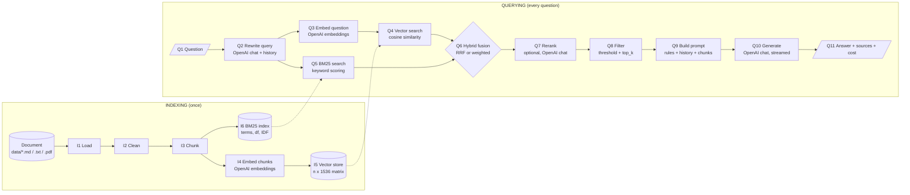
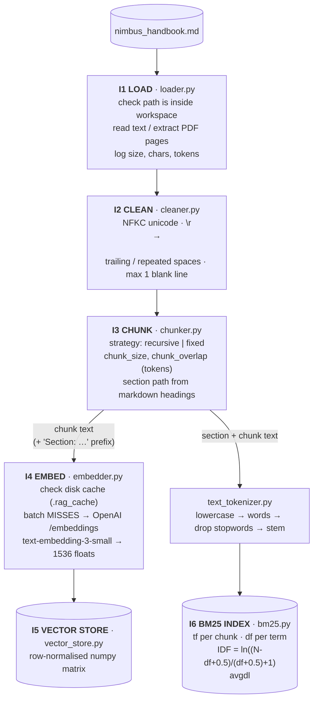
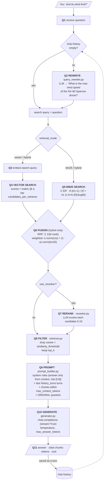

# RAG Pipeline: Flow Diagram

The bot works in two phases:

1. **Indexing** runs once at start-up. It turns the document into something searchable.
2. **Querying** runs for every question. It finds the relevant chunks and lets the LLM answer from them.

Every box carries a step code (`I1`… / `Q1`…). The same code appears as a header in the terminal logs, so you can match what you see on screen to this diagram and to the file that does the work.

> The Mermaid diagrams below render on GitHub and in VS Code (with a Mermaid extension).
> The same picture in plain text is printed in the terminal at start-up, and again whenever you type `/diagram`.

---

## 1. Overview

---

## 2. Indexing phase in detail

---

## 3. Query phase in detail

---

## 4. Which file does what

| Step | What happens | File | Settings that change it |
|---|---|---|---|
| I1 | Load the file (workspace only) | `rag/ingestion/loader.py` | `document_path` |
| I2 | Normalise text | `rag/ingestion/cleaner.py` | (none) |
| I3 | Split into chunks | `rag/ingestion/chunker.py` | `chunk_strategy`, `chunk_size`, `chunk_overlap`, `prepend_section_title` |
| I4 / Q3 | Text → vector | `rag/embeddings/embedder.py`, `cache.py` | `embedding_model`, `use_embedding_cache` |
| I5 / Q4 | Cosine similarity search | `rag/retrieval/vector_store.py`, `similarity.py` | `candidates_per_retriever` |
| I6 / Q5 | BM25 keyword search | `rag/retrieval/bm25.py`, `text_tokenizer.py` | `bm25_k1`, `bm25_b`, `bm25_remove_stopwords`, `bm25_use_stemming` |
| Q2 | Rewrite follow-up questions | `rag/generation/query_rewriter.py` | `use_query_rewriting`, `history_turns` |
| Q6 | Merge both rankings | `rag/retrieval/hybrid.py` | `retrieval_mode`, `fusion_method`, `hybrid_alpha`, `rrf_k` |
| Q7 | LLM reranking | `rag/retrieval/reranker.py` | `use_reranker` |
| Q8 | Threshold + top_k | `rag/retrieval/retriever.py` | `similarity_threshold`, `top_k` |
| Q9 | Build the prompt | `rag/generation/prompt_builder.py` | `max_context_tokens`, `history_turns` |
| Q10 | Stream the answer | `rag/generation/generator.py` | `chat_model`, `temperature`, `max_answer_tokens` |
| Q11 | Sources, tokens, cost | `rag/pipeline.py` | (none) |
